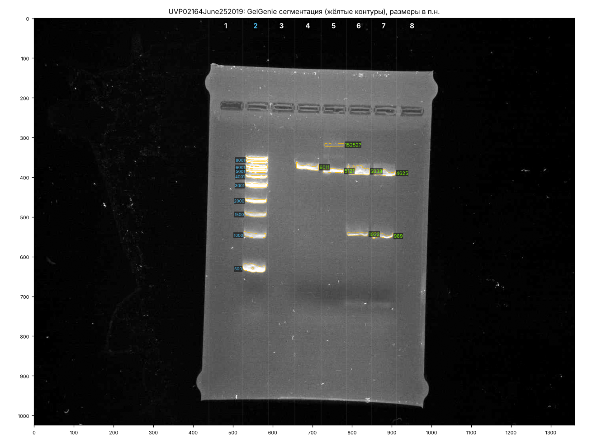
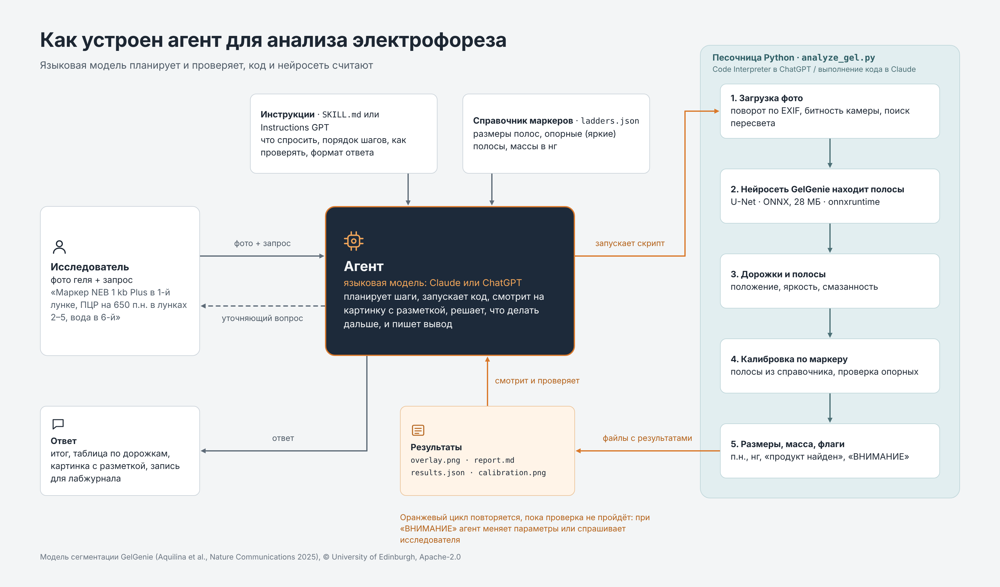

# Агент для анализа электрофореза

ИИ-агент, который разбирает фото агарозного геля (ДНК-электрофорез: ПЦР, рестрикция, проверка плазмид). Он находит полосы
нейросетью [GelGenie](https://github.com/mattaq31/GelGenie), определяет их размеры по маркеру, проверяет ожидаемые продукты
и отрицательный контроль, отмечает праймер-димеры, смазанность и пересвет, а затем пишет короткий вывод и запись
для лабораторного журнала.

Работает без программирования: как скилл в Claude или как свой GPT в ChatGPT. Скрипт можно запускать и локально.



## Как устроен агент



| Часть | Что это | Где лежит |
|---|---|---|
| Модель | Claude или ChatGPT: понимает запрос, решает, что делать, проверяет результат | платформа |
| Инструкции | порядок работы, что спросить у исследователя, как проверять, формат ответа | `claude_skill/.../SKILL.md`, `chatgpt_gpt/GPT_instructions.txt` |
| Инструменты | скрипт `analyze_gel.py` и нейросеть GelGenie в формате ONNX | `claude_skill/.../scripts`, `claude_skill/.../model` |
| Знания | справочник маркеров: размеры полос, опорные полосы, массы | `claude_skill/.../ladders.json` |
| Цикл проверки | агент смотрит на разметку и предупреждения и при необходимости перезапускает скрипт или задаёт вопрос | описан в инструкциях |

Главный принцип: всё, что можно измерить, считает код; понимание задачи, выбор шагов и проверку делает языковая модель.

## Быстрый старт

Готовые архивы для установки лежат на странице [Releases](../../releases):

- `gel-electrophoresis-analyzer.zip` — скилл для Claude;
- `chatgpt-gpt-files.zip` — файлы для своего GPT в ChatGPT;
- `onnxruntime-*.whl` — запасной `onnxruntime` для песочницы ChatGPT (Python 3.11 и 3.12).

### Claude (Pro, Max, Team, Enterprise)

1. Настройки → Capabilities: включите **Code execution and file creation** и **Allow network egress**
   (доступ к PyPI нужен, чтобы песочница поставила `onnxruntime`).
2. Настройки → Capabilities → Skills → **Upload skill** → `gel-electrophoresis-analyzer.zip` из Releases.
   Если скачали репозиторий целиком, заархивируйте папку `claude_skill/gel-electrophoresis-analyzer` в zip
   (папка должна быть внутри архива).
3. В новом чате прикрепите фото геля и напишите запрос (пример ниже).

### ChatGPT (Plus и выше)

1. Explore GPTs → Create → Configure.
2. **Instructions**: вставьте текст из `chatgpt_gpt/GPT_instructions.txt`.
3. **Knowledge**: загрузите файлы из `chatgpt-gpt-files.zip` (распакуйте архив): `analyze_gel.py`, `ladders.json`,
   `gelgenie_model.zip`, `NOTICE.md` и, на случай если в песочнице нет `onnxruntime`, wheel-файлы `onnxruntime-*.whl`
   из Releases.
4. **Capabilities**: включите Code Interpreter & Data Analysis.
5. Откройте свой GPT, прикрепите фото геля и напишите запрос.

Подробнее и что делать, если Knowledge не принимает файлы, — в [`chatgpt_gpt/README.md`](chatgpt_gpt/README.md).

### Локально (Python 3.9+)

```bash
pip install -r requirements.txt
python claude_skill/gel-electrophoresis-analyzer/scripts/analyze_gel.py test_gels/UVP02164June252019.jpg \
    --ladder neb_1kb --ladder-lanes 2 --add-empty-left 1 --add-empty-right 1 --out results
```

Скрипт сохранит в `results/` картинку с разметкой (`*_overlay.png`), таблицу (`*_report.md`), полные данные
(`*_results.json`) и график калибровки (`*_calibration.png`). Проверка установки: `python tests/test_smoke.py`.

## Как писать запрос

Укажите маркер и номер его лунки (лунки считаются слева направо, включая пустые), что в остальных лунках,
ожидаемые размеры и где отрицательный контроль. Например:

> Вот гель. Маркер NEB 1 kb Plus в 1-й и 12-й лунках. В 2–10 ПЦР на 650 п.н., в 11-й вода.

Для оценки массы ДНК добавьте, сколько маркера и образца внесли: «маркер 500 нг, образцы по 5 мкл».
Если чего-то не хватает, агент спросит сам или сделает первый прогон и покажет разметку.

Советы для точных размеров:

- ставьте маркер по обоим краям геля: это сильнее всего повышает точность;
- снимайте без пересвета; лучше всего — 16-битный TIFF с гель-документатора;
- фото с телефона подходят, поворот по EXIF учитывается автоматически.

## Маркеры

Пресеты в `ladders.json`:

| Пресет | Маркер |
|---|---|
| `neb_1kb_plus` | NEB 1 kb Plus (N3200 / N0550), с массами полос |
| `neb_1kb` | NEB 1 kb (N3232) |
| `neb_100bp` | NEB 100 bp (N3231) |
| `invitrogen_1kb_plus` | Invitrogen 1 Kb Plus (10787018), текущая версия: 100–15000 п.н., опорная 1500 |
| `invitrogen_1kb_plus_old` | Invitrogen 1 Kb Plus, старая версия: 100–12000 п.н., опорная 1650 |
| `generuler_1kb` | Thermo GeneRuler 1 kb (SM0311) |
| `generuler_1kb_plus` | Thermo GeneRuler 1 kb Plus (SM1331) |
| `generuler_100bp_plus` | Thermo GeneRuler 100 bp Plus (SM0321) |

Свой маркер: передайте размеры через `--ladder-sizes "3000,2000,1500,…"` или добавьте запись в `ladders.json`
(`sizes_bp` по убыванию, `bright_bp` — яркие опорные полосы, по желанию `mass_ng_per_ug` — массы полос на 1 мкг).
Сверяйте размеры с паспортом своей партии: у одного каталожного номера бывают разные версии маркера.

## Параметры скрипта

| Параметр | Что делает |
|---|---|
| `--ladder`, `--ladder-sizes` | пресет маркера или свой список размеров |
| `--ladder-lanes 1,12` | номера дорожек с маркером (лучше два, по краям) |
| `--expected "2=650,3=650/1200"` | ожидаемые размеры по дорожкам |
| `--negative 11` | дорожки отрицательного контроля |
| `--add-empty-left N`, `--add-empty-right N` | добавить пустые лунки по краям (скрипт видит дорожки по полосам) |
| `--lane-centers "x1,x2,…"` | задать центры дорожек вручную, в пикселях |
| `--ladder-first-bp 10002` | размер самой верхней найденной полосы маркера, если подписи сдвинуты |
| `--ladder-ng 500 --sample-ul 5` | оценка массы ДНК в полосах (нужен маркер с массами) |
| `--invert yes/no`, `--norm percentile` | тёмные полосы на светлом фоне; очень тусклые фото |
| `--tolerance 0.1` | допуск при сравнении с ожидаемым размером |

## Ограничения

- Это помощник для рутины, а не валидированный метод для диагностики. Проверяйте агента на своих гелях
  с известным результатом, прежде чем доверять ему.
- Размеры у краёв диапазона маркера (самые мелкие и самые крупные полосы) и на гелях с сильной «улыбкой» или перекосом
  менее точны. Близкие полосы и слившиеся верхние полосы маркера могут объединиться.
- Масса ДНК оценивается полуколичественно; для точной концентрации нужны флуориметрия или спектрофотометрия.
- Если скрипт пишет «ВНИМАНИЕ», агент должен проверить разметку глазами и при необходимости уточнить маркер.

## Откуда модель

В репозитории лежит модель **GelGenie Universal FineTune (May 2024)**, сконвертированная в float16
(`claude_skill/gel-electrophoresis-analyzer/model/gelgenie_unet_fp16.onnx`, 28,7 МБ). Оригинал (float32, 57 МБ) —
на Hugging Face:
[mattaq/GelGenie-Universal-FineTune-May-2024](https://huggingface.co/mattaq/GelGenie-Universal-FineTune-May-2024/tree/main/onnx_checkpoints),
файл `onnx_checkpoints/unet_dec_21_finetune_epoch_590.onnx`.

| Файл | SHA-256 |
|---|---|
| оригинал `unet_dec_21_finetune_epoch_590.onnx` | `df9e39157eda6e1d1f034f5ca75fb2b8d0965189c026f00504a80c2743bb6336` |
| в репозитории `gelgenie_unet_fp16.onnx` | `4ab1c89639cddb7fa5aebe50bd81de741d8668578f5c6d41b1d248b62f771b2f` |

Почему модель лежит в репозитории, а не скачивается при запуске: песочницы Claude и ChatGPT часто не имеют доступа
к Hugging Face, а Claude принимает файлы до 30 МБ — поэтому нужна копия float16. Маски полос у float16 и float32
практически совпадают. Получить float16 из оригинала самостоятельно: `python tools/fetch_model.py` (нужны `onnx`
и `onnxconverter-common`).

## Структура репозитория

```
claude_skill/gel-electrophoresis-analyzer/   скилл: SKILL.md, скрипт, справочник маркеров, модель
chatgpt_gpt/                                 инструкции и порядок сборки своего GPT
test_gels/                                   5 гелей из открытого набора GelGenie для первого запуска
examples/                                    разметка и отчёты агента на тестовых гелях
docs/                                        схема агента
tools/build_release.py                       сборка архивов для Releases
tools/fetch_model.py                         скачать оригинальную модель и сконвертировать в float16
tests/test_smoke.py                          быстрая проверка установки
```

Сборка архивов для Releases: `python tools/build_release.py` (с `--wheels` — добавить офлайн-wheel `onnxruntime`
для ChatGPT). Архивы появятся в `dist/`.

## Лицензии и благодарности

- Код и инструкции этого репозитория — Apache License 2.0 (`LICENSE`).
- Модель сегментации — GelGenie, © University of Edinburgh, Apache License 2.0; изменение: конвертация в float16
  (`claude_skill/gel-electrophoresis-analyzer/NOTICE.md`).
- Тестовые гели — набор данных GelGenie на Zenodo ([10.5281/zenodo.13218469](https://doi.org/10.5281/zenodo.13218469)),
  CC BY 4.0 (`test_gels/README.md`).

Если используете агента в работе, цитируйте GelGenie:

> Aquilina M. et al. GelGenie: an AI-powered framework for gel electrophoresis image analysis.
> Nature Communications 16, 2025. https://doi.org/10.1038/s41467-025-59189-0

## English summary

An AI agent for agarose gel photos (PCR, restriction digests, plasmid checks) packaged as a Claude Skill and as a custom
GPT. Band segmentation uses the open GelGenie U-Net (ONNX, converted to float16); a Python script assigns lanes, calibrates
against the DNA ladder, estimates band sizes and semi-quantitative DNA mass, and flags issues; the language model checks the
overlay and writes the report. See the sections above for setup; the code is Apache-2.0.
